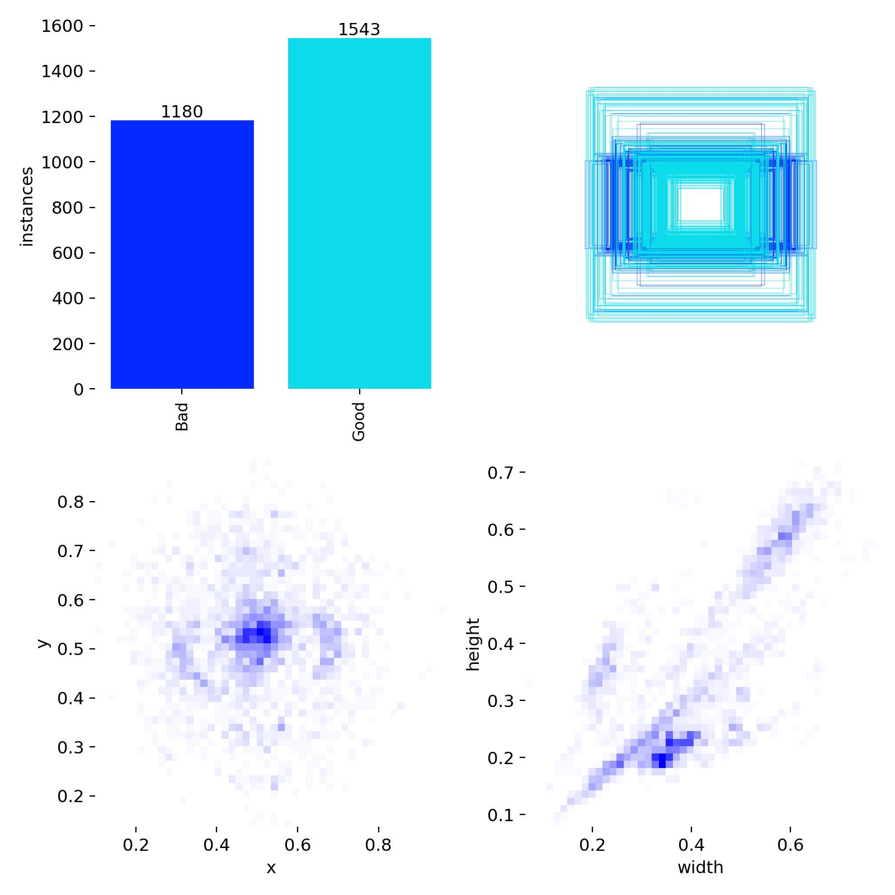
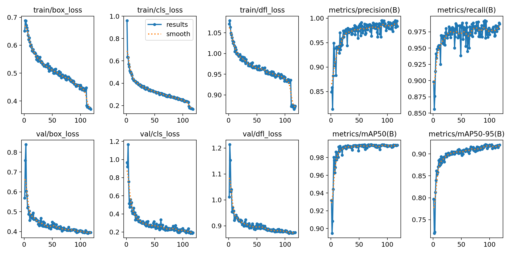
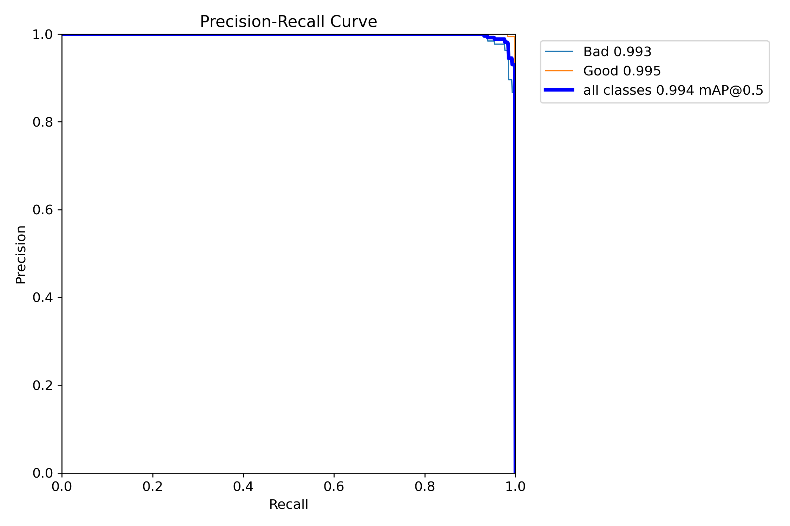
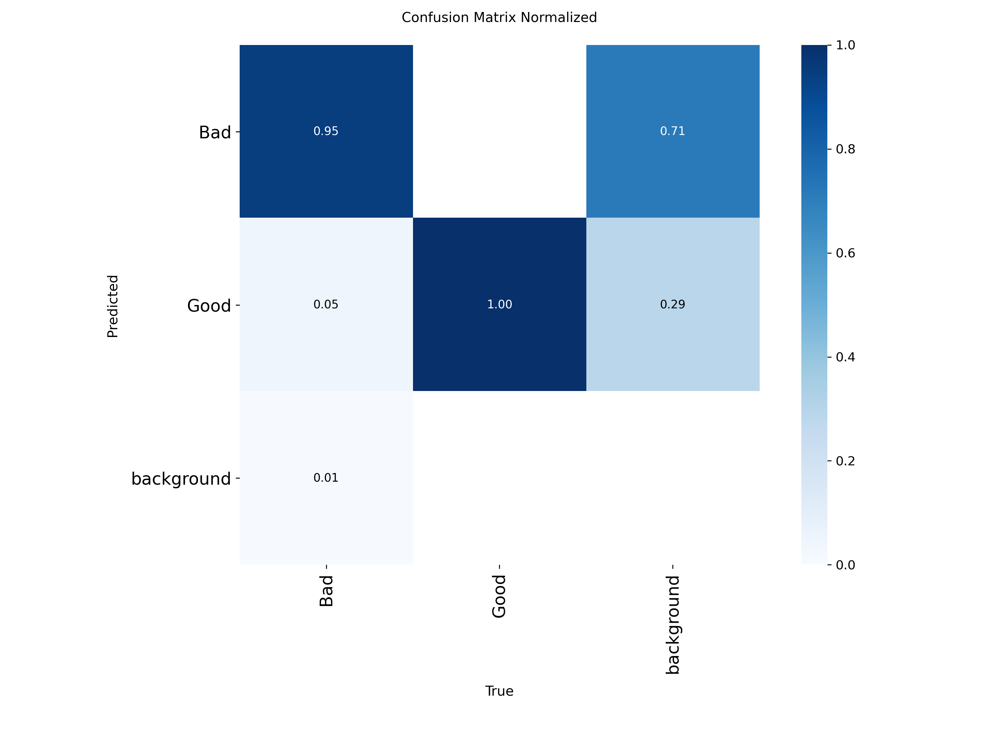

# Huấn luyện và đánh giá mô hình YOLOv8s

Thư mục này trình bày quá trình chuẩn bị dữ liệu, huấn luyện và đánh giá mô hình **YOLOv8s** dùng trong hệ thống phân loại chất lượng quả chanh.

Mô hình thực hiện bài toán **Object Detection** với hai lớp:

- `Good`: chanh tốt
- `Bad`: chanh hỏng

Sau khi huấn luyện, trọng số tốt nhất `best.pt` được sử dụng trong chương trình Python để nhận diện quả chanh từ webcam theo thời gian thực.

---

## 1. Tổng quan

| Thông tin | Chi tiết |
|---|---|
| Bài toán | Object Detection |
| Mô hình | YOLOv8s |
| Framework | Ultralytics |
| Dataset | Roboflow v7 |
| Classes | Good / Bad |
| Tổng số ảnh | 2.524 |
| Tổng số đối tượng | 3.353 |
| Môi trường huấn luyện | Kaggle |
| GPU | NVIDIA Tesla T4 |
| Trọng số tốt nhất | `best.pt` |

---

## 2. Bộ dữ liệu

Bộ dữ liệu gồm hình ảnh quả chanh được gán nhãn bằng **bounding box** và chia thành hai lớp `Good` và `Bad`.

### Thống kê toàn bộ dữ liệu

| Class | Số đối tượng |
|---|---:|
| Good | 1.884 |
| Bad | 1.469 |
| **Tổng cộng** | **3.353** |

### Phân chia dữ liệu

| Dataset | Tỷ lệ | Số ảnh |
|---|---:|---:|
| Train | 80% | 2.030 |
| Validation | 10% | 246 |
| Test | 10% | 248 |
| **Tổng cộng** | **100%** | **2.524** |

Dữ liệu được tiền xử lý trên Roboflow bằng:

- Auto-Orient
- Resize về `640 × 640`
- Không tạo thêm ảnh augmentation cố định trên Roboflow

Các phép augmentation được Ultralytics áp dụng trực tuyến trong quá trình huấn luyện.

---

## 3. Phân bố dữ liệu huấn luyện

Tập Train có tổng cộng **2.723 đối tượng**, gồm:

| Class | Số đối tượng |
|---|---:|
| Good | 1.543 |
| Bad | 1.180 |
| **Tổng cộng** | **2.723** |

Hình dưới thể hiện phân bố lớp, vị trí và kích thước bounding box trong tập huấn luyện.



---

## 4. Cấu hình huấn luyện

Mô hình `yolov8s.pt` đã được pretrained được sử dụng làm trọng số khởi tạo.

Quá trình huấn luyện được thực hiện trên **Kaggle** với GPU **NVIDIA Tesla T4**.

| Tham số | Giá trị |
|---|---|
| Model | `yolov8s.pt` |
| Task | Detection |
| Maximum Epochs | 120 |
| Actual Epochs | 118 |
| Early Stopping | `patience=25` |
| Batch Size | 16 |
| Image Size | `640 × 640` |
| Optimizer | `auto` |
| Seed | 42 |
| Device | NVIDIA Tesla T4 (`device=0`) |
| AMP | `True` |
| Validation | `True` |

Mô hình được đánh giá trên tập Validation sau mỗi epoch.

Giá trị fitness tốt nhất được ghi nhận tại **epoch 93**. Sau 25 epoch tiếp theo không có cải thiện, cơ chế Early Stopping kết thúc quá trình huấn luyện tại epoch 118.

Trọng số tốt nhất được Ultralytics lưu thành:

```text
best.pt
```

---

## 5. Data Augmentation

Ultralytics áp dụng các phép augmentation trực tuyến cho dữ liệu Train trong quá trình huấn luyện.

| Augmentation | Giá trị |
|---|---|
| Hue | `hsv_h=0.015` |
| Saturation | `hsv_s=0.7` |
| Value | `hsv_v=0.4` |
| Translation | `translate=0.1` |
| Scale | `scale=0.5` |
| Horizontal Flip | `fliplr=0.5` |
| Vertical Flip | `flipud=0.0` |
| Mosaic | `mosaic=1.0` |
| Close Mosaic | `close_mosaic=10` |

Mosaic được sử dụng trong phần lớn quá trình huấn luyện và được tắt trong **10 epoch cuối**.

`MixUp` và `CutMix` không được sử dụng.

Các phép augmentation này chỉ áp dụng cho tập Train.

---

## 6. Kết quả huấn luyện

Biểu đồ dưới đây thể hiện quá trình thay đổi của các hàm loss và chỉ số đánh giá trong quá trình huấn luyện YOLOv8s.



Các chỉ số chính bao gồm:

- Box Loss
- Classification Loss
- Distribution Focal Loss
- Precision
- Recall
- mAP@0.5
- mAP@0.5:0.95

Trọng số tốt nhất được ghi nhận tại **epoch 93**.

---

## 7. Kết quả trên tập Validation

Kết quả của mô hình trên tập Validation:

| Metric | Kết quả |
|---|---:|
| Precision | 98,66% |
| Recall | 96,54% |
| mAP@0.5 | 99,39% |
| mAP@0.5:0.95 | 92,15% |

### Precision-Recall Curve



### Confusion Matrix



Kết quả Validation cho thấy mô hình có khả năng nhận diện tốt hai lớp `Good` và `Bad` trên dữ liệu xác thực được sử dụng trong quá trình huấn luyện.

---

## 8. Kết quả trên tập Test Roboflow v7

Sau khi huấn luyện, trọng số tốt nhất `best.pt` được đánh giá trên **248 ảnh Test** của bộ dữ liệu Roboflow v7.

| Metric | Kết quả |
|---|---:|
| Precision | 98,53% |
| Recall | 96,88% |
| mAP@0.5 | 98,67% |
| mAP@0.5:0.95 | 90,80% |

AP@0.5 theo từng lớp:

| Class | AP@0.5 |
|---|---:|
| Bad | 98,4% |
| Good | 98,9% |

> **Lưu ý:** Bộ dữ liệu Roboflow v7 được phân chia theo ảnh. Một số ảnh chụp ở các góc khác nhau của cùng một quả chanh có thể xuất hiện ở cả tập Train và Test. Vì vậy, kết quả trên tập Test v7 được sử dụng như kết quả tham khảo và không được chọn làm kết quả chính để đánh giá khả năng tổng quát hóa của mô hình.

---


## 9. Kiểm thử trên bộ dữ liệu v4

Để đánh giá khả năng tổng quát hóa, mô hình YOLOv8s được kiểm thử bổ sung trên bộ dữ liệu v4, được thu thập trong một đợt riêng với bộ dữ liệu huấn luyện v7.

Bộ dữ liệu v4 gồm 246 ảnh:
- Test: 243 ảnh
- Validation: 3 ảnh
- Train: 0 ảnh

Tập Test ban đầu chứa 243 ảnh và 265 đối tượng, gồm 220 Bad và 45 Good.

### 9.1. Kiểm tra trùng lặp dữ liệu

Quá trình kiểm tra tính độc lập dữ liệu phát hiện 24 ảnh trùng chính xác giữa tập Test v4 và tập Validation v7.

Ngoài ra, phép kiểm tra bằng dHash phát hiện 291 cặp ảnh có độ tương đồng cao. Các ảnh nghi ngờ đã được kiểm tra trực quan, cho thấy sự trùng lặp hoặc tương đồng về nội dung ảnh giữa hai bộ dữ liệu.

Do đó, việc thu thập dữ liệu ở các đợt khác nhau không đảm bảo tính độc lập hoàn toàn ở mức hình ảnh hoặc từng quả chanh.

### 9.2. Tạo tập kiểm thử sau khi loại ảnh trùng chính xác

Để đánh giá ảnh hưởng của việc trùng lặp, 24 ảnh trùng chính xác với tập Validation v7 được loại khỏi tập Test v4.

Tập kiểm thử sau khi lọc gồm:

| Thông tin | Giá trị |
|---|---:|
| Số ảnh ban đầu | 243 |
| Số ảnh loại bỏ | 24 |
| Số ảnh còn lại | 219 |
| Bad | 206 |
| Good | 35 |
| Tổng số đối tượng | 241 |

Việc lọc này chỉ loại bỏ các ảnh trùng chính xác đã xác định. Các trường hợp near-duplicate khác chưa được loại khỏi tập kiểm thử.

### 9.3. Kết quả đánh giá YOLOv8s

Mô hình YOLOv8s cuối cùng được đánh giá tại độ phân giải 320 pixels, confidence 0.001 và NMS IoU 0.7, sử dụng Ultralytics 8.4.132.

| Metric | Test gốc (243 ảnh) | Test sau lọc (219 ảnh) |
|---|---:|---:|
| Precision | 94.65% | 93.37% |
| Recall | 96.46% | 96.22% |
| mAP@0.5 | 98.68% | 98.60% |
| mAP@0.5:0.95 | 85.43% | 84.79% |

Sau khi loại bỏ 24 ảnh trùng chính xác, mAP@0.5:0.95 giảm từ 85.43% xuống 84.79%, tương đương khoảng 0.64 điểm phần trăm.

Kết quả cho thấy hiệu năng của mô hình vẫn tương đối ổn định sau khi loại bỏ phần trùng lặp chính xác đã xác định. Tuy nhiên, kết quả này không chứng minh được tính độc lập hoàn toàn ở mức từng quả chanh vật lý.

---

## 10. So sánh kết quả đánh giá

| Dataset | Precision | Recall | mAP@0.5 | mAP@0.5:0.95 |
|---|---:|---:|---:|---:|
| Validation v7 | 98.66% | 96.54% | 99.39% | 92.15% |
| Roboflow v7 Test | 98.53% | 96.88% | 98.67% | 90.80% |
| v4 Test (243 ảnh) | 94.65% | 96.46% | 98.68% | 85.43% |
| v4 Test sau lọc (219 ảnh) | 93.37% | 96.22% | 98.60% | 84.79% |

Kết quả trên tập Test v4 và tập Test sau lọc được sử dụng để phân tích khả năng tổng quát hóa và ảnh hưởng của hiện tượng trùng lặp ảnh.

Các kết quả này cần được diễn giải trong giới hạn của dữ liệu hiện có, do chưa xác minh được tính độc lập hoàn toàn giữa các quả chanh vật lý.

---

## 11. Cấu hình đánh giá

Các lần đánh giá trên tập Test v4 sử dụng checkpoint YOLOv8s cuối cùng.

| Tham số | Giá trị |
|---|---|
| Model | YOLOv8s |
| Weights | best.pt |
| Evaluation | model.val() |
| Image Size | 320 |
| Confidence | 0.001 |
| NMS IoU | 0.7 |
| Batch Size | 16 |
| Device | NVIDIA Tesla T4 |
| Ultralytics | 8.4.132 |

### Software Environment

The following software versions were recorded from the Kaggle evaluation environment:

| Component | Version |
|---|---|
| Python | 3.12.13 |
| PyTorch | 2.10.0+cu128 |
| CUDA (PyTorch) | 12.8 |
| Ultralytics | 8.4.132 |
| OpenCV | 4.13.0.92 |
| NumPy | 2.4.6 |
| Pandas | 2.3.3 |
| Torchvision | 0.25.0+cu128 |
| GPU | NVIDIA Tesla T4 |

PySerial was not installed in the Kaggle environment because UART communication was not required for offline model evaluation.

These versions describe the inspected evaluation environment and should not be assumed to represent the original training environment without further verification.

Cấu hình này áp dụng cho kết quả đánh giá v4 được báo cáo trong Mục 9 và Mục 10.

Checkpoint có thể tải tại:

https://github.com/kh4ng-tayto/stm32-lemon-sorting/releases/download/v1.0-model/best.pt

Việc tái lập kết quả yêu cầu sử dụng đúng checkpoint, bộ dữ liệu, cấu hình đánh giá và phiên bản phần mềm tương ứng.


## 12. Triển khai mô hình

Cấu hình huấn luyện và đánh giá ngoại tuyến sử dụng:

```text
imgsz=640
```

Khi triển khai mô hình nhận diện theo thời gian thực từ webcam, hệ thống sử dụng:

```text
imgsz=320
confidence=0.60
```

Kích thước ảnh nhỏ hơn được sử dụng nhằm giảm khối lượng tính toán và duy trì tốc độ xử lý gần thời gian thực.

Trong quá trình thử nghiệm, tốc độ hiển thị đạt khoảng:

```text
30.2 - 31.4 FPS
```

---

## 13. Luồng hoạt động

```text
Lemon Dataset
      │
      ▼
Data Annotation
      │
      ▼
Train / Validation / Test
      │
      ▼
YOLOv8s Pretrained Model
      │
      ▼
Model Training
      │
      ▼
Validation
      │
      ▼
best.pt
      │
      ▼
Independent Test
      │
      ▼
Model Evaluation
      │
      ▼
Real-time Deployment
```

Khi triển khai trong hệ thống:

```text
USB Webcam
     │
     ▼
OpenCV
     │
     ▼
YOLOv8s (best.pt)
     │
     ▼
Good / Bad Detection
     │
     ▼
Sorting Logic
     │
     ▼
UART
     │
     ▼
STM32F103C6T6
     │
     ▼
Servo Sorting Mechanism
```

Máy tính đảm nhiệm xử lý ảnh và chạy YOLOv8s. STM32F103C6T6 nhận kết quả phân loại thông qua UART và điều khiển cơ cấu gạt sản phẩm.

---


## 14. Kết luận

Mô hình YOLOv8s được huấn luyện trên bộ dữ liệu Roboflow v7 gồm 2.524 ảnh và 3.352 đối tượng trong bản xuất YOLO, thuộc hai lớp Bad và Good.

Mô hình được đánh giá bổ sung trên bộ dữ liệu v4 gồm 243 ảnh Test. Sau khi kiểm tra trùng lặp, 24 ảnh trùng chính xác với tập Validation v7 được loại bỏ.

Kết quả trên 219 ảnh còn lại đạt:

- Precision: 93.37%
- Recall: 96.22%
- mAP@0.5: 98.60%
- mAP@0.5:0.95: 84.79%

Kết quả sau lọc cho thấy mô hình vẫn duy trì hiệu năng phát hiện tốt trên tập dữ liệu được kiểm tra. Tuy nhiên, nghiên cứu chưa thể xác nhận tính độc lập hoàn toàn ở mức từng quả chanh vật lý.

Checkpoint YOLOv8s và mã nguồn triển khai được cung cấp trong repository để hỗ trợ việc kiểm tra và tái lập các kết quả đã báo cáo.


## Cấu trúc thư mục

```text
training/
├── README.md
└── images/
    ├── dataset_distribution.png
    ├── results.png
    ├── pr_curve_validation.png
    ├── confusion_matrix_validation.png
    ├── pr_curve_independent.png
    └── confusion_matrix_independent.png
```
